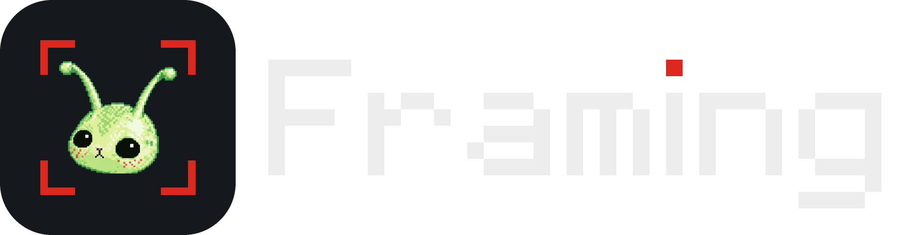

# Framing

A video toolkit for plates and shots: grab frames, retime, reverse, convert, compare, split cuts, rename.
It runs on Windows from a single `Framing.bat`, on a Mac from `Framing.command` or as `Framing.app`, and as a small web service.
Everything is processed on your own machine (or your own server for the web version).



## Using it

**Windows.** Download the zip from [Releases](../../releases), extract it, and double-click `Framing.bat`. It opens in your browser.
On first launch it puts a Framing shortcut with the app icon on your desktop.
`Framing_App.bat` opens the same tool in its own window (Electron) instead of the browser, with the system file dialogs and drag and drop from Explorer.

**Mac.** Double-click `Framing.command`. The first run sets up Python packages in `app/.venv-mac` (about a minute) and needs FFmpeg from Homebrew (`brew install ffmpeg`).
To build a real `Framing.app`, run `app/mac/Mac에서_빌드.command` on a Mac; see [app/mac/README.md](app/mac/README.md).

**Web.** `app/web` is a Docker Compose service with HTTPS through Caddy, for a small team behind one shared password. See [app/web/README.md](app/web/README.md).

Any launcher also works as a command-line tool when you give it arguments:

```
Framing.bat extract shot.mov --at 1,50%,last
Framing.bat retime shot.mov --frames 264 --retime-mode motion --note
./Framing.command compare before.mov after.mov --view side --keep
```

What it does:

| Tool | |
|---|---|
| Grab | Chosen frames, evenly spaced frames, or every frame as PNG / JPG / EXR / DPX |
| Retime | Change length or speed with duplicate, hold, blend, motion (FFmpeg) or RIFE interpolation, and write a retime note |
| Revert | Bring a retimed clip back to its source length from the note (sidecar text or embedded tag) |
| Reverse | Play a clip or an image sequence backwards |
| Convert | MP4, Nuke-ready MOV, delivery naming, smaller files, GIF, image sequences and back |
| Compare | Two clips or images side by side, wipe, overlay or flicker, with sound; save as a movie or PNG |
| Split cuts | By detected scene changes, a fixed interval, or times you type |
| Shot check · contact sheet | Frozen frames and other candidates to review, and a one-page overview of a shot |
| Rename | Batch rename with numbering, find/replace and undo |

Notes and project files made by SHOTKIT (the earlier name of this tool) still open.

## Working on it

This repo does not include the Windows runtime (`app/python`, `app/lib`, `app/ffmpeg`, `app/rife`, about 620 MB); it is too big for Git.
Copy those four folders once from the release zip into the same place in your clone, and `Framing.bat` runs.

```
git clone https://github.com/ppqwpe/framing.git Framing
(copy app\python, app\lib, app\ffmpeg and app\rife from the release zip into Framing\app\)
Framing\Framing.bat
```

Run the tests after any change. All of them should pass.

```
app\python\python.exe app\tests\run_tests.py
```

The Electron window needs `pnpm install` once in `app/electron` (its `node_modules` is not in Git, about 330 MB).

A few UI checks need Node.js on `PATH`; without it they are skipped and reported. The web service has its own tests in `app/web/tests`.

Build a new Windows release zip like this. It lands next to the repo folder as `Framing_1.0_windows.zip`.

```
app\python\python.exe app\tools\build_zip.py
```

### Layout

One engine, three ways to run it.

| Path | What's there |
|---|---|
| `Framing.bat` | Windows launcher: embedded Python, opens the UI in the browser |
| `Framing_App.bat` | Windows launcher for the Electron window (`app/electron`) |
| `Framing.command` | Mac launcher from source: venv + Homebrew FFmpeg, same UI in the browser |
| `app/main.py` | Entry point both launchers run; with arguments it is the command-line tool |
| `app/framing/` | The engine, split by job (see below), and the whole desktop UI in one file (`ui.html`) |
| `app/electron/` | Electron window: starts the engine with `FRAMING_MODE=electron`, opens its address, stops it on close |
| `app/mac/` | Native Mac app: pywebview window, PyInstaller spec and build script for `Framing.app` |
| `app/web/` | Web service: FastAPI server, job worker, browser UI, Dockerfile, Compose and Caddy config |
| `app/tests/` | Automated tests, including SHOTKIT-era file compatibility |
| `app/tools/` | `make_logo.py` (icons, logo PNGs, the pixel mascot in the UI) and `build_zip.py` |
| `app/icon/` | App and shortcut icon |
| `app/licenses/` | License texts for bundled components |
| `logo/` | Logo PNGs and the mascot source image |

### Inside `app/framing`

| Module | What's there |
|---|---|
| `env.py` | Build number, launcher path, where bundled FFmpeg and RIFE live, dependency setup, `cv2` / `numpy` |
| `errors.py` · `options.py` · `util.py` · `i18n.py` | Errors, job options, console and path helpers, the Korean → English strings |
| `media.py` · `frames.py` | Reading video and sequences, ffprobe, running FFmpeg; saving frames, colour range, mattes |
| `retime.py` · `plate.py` | Retime plans, notes and interpolation engines; RIFE plates, stretch notes, hold and revert |
| `job.py` · `registry.py` | The `Job` base class and the table of job names (old names included) |
| `jobs_*.py` | One file per tool: extract, reverse, retime, convert, compare, rename, plate, review |
| `sequence.py` · `cuts.py` · `audit.py` · `compare_page.py` · `compare_export.py` | Pieces those jobs share |
| `cli.py` · `app.py` · `api.py` · `server.py` | Command line, job runner, the API the UI calls, the local HTTP server |
| `checkup.py` · `desktop.py` | Diagnostics and first-run setup; the UI document, window, desktop shortcut and `main()` |
| `core.py` | One import that exposes every name above, for the launchers, the Mac app, the web worker and the tests |

Launchers change runtime settings on `framing.env` (`env.SELF`, `env.BUILD`, `env.FFMPEG_HOME`, `env.RIFE_HOME`), not on `core`, so every module sees them.

To change the logo, edit `app/tools/make_logo.py` and run it. It rewrites the icons, the PNGs in `logo/`, and the pixel mascot between the `// <alien>` markers in `app/framing/ui.html`.

### Workflow

Keep `main` releasable at all times. Make changes on a separate branch, and merge into `main` once the tests pass.
To ship, build the zip with `build_zip.py` and attach it to a new GitHub Release with a version number (v1.1 and so on).

## Bundled components and licenses

| Component | License |
|---|---|
| Python 3.12 (Windows embeddable) | PSF |
| NumPy, OpenCV (headless), Pillow | BSD-3-Clause, Apache-2.0, MIT-CMU |
| FFmpeg 9.0 full build (gyan.dev), a separate unmodified program | GPL-3.0 |
| RIFE ncnn Vulkan 20221029 with the v4.6 model | MIT |

Details and source links are in [THIRD_PARTY_NOTICES.md](THIRD_PARTY_NOTICES.md).
